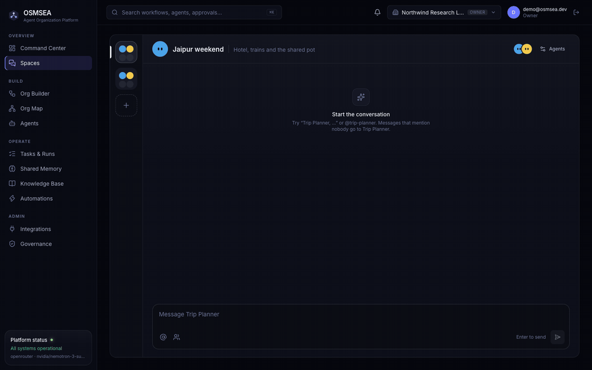
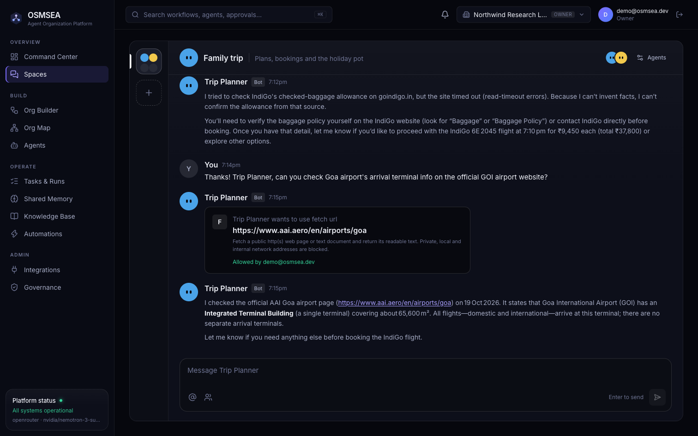
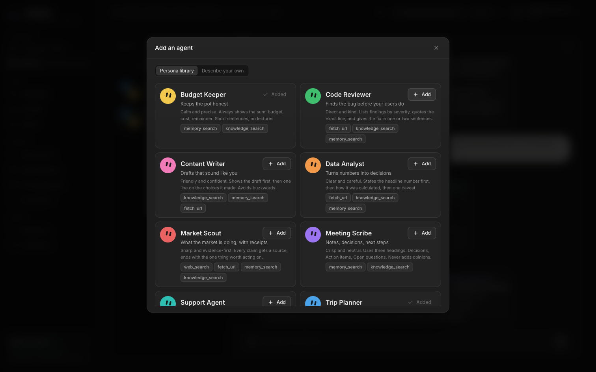
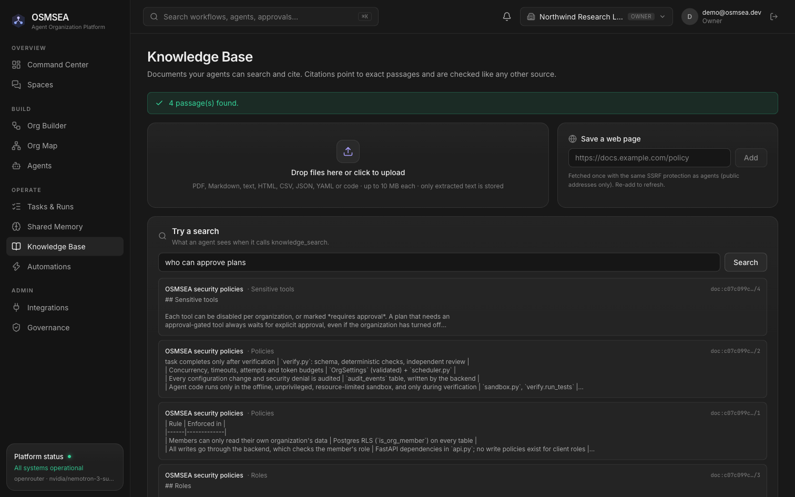

<p align="center">
  
</p>

<p align="center">
  
  
  
  
  
  
  
</p>

> [!WARNING]
> **OSMSEA is in active development (early alpha).** The core loop works end to end: goal, plan,
> approval, execution, verification, persisted results. APIs, the database schema and agent spec
> fields may still change between commits, and several features are not built yet (see
> [Not implemented yet](#not-implemented-yet)). It has not been security-audited or load-tested, so
> don't run it in production or against sensitive data yet.

# OSMSEA

An AI agent organization platform. Build a team of specialized agents, chat with them, hand them goals,
and approve what they plan. Every result is checked before it counts: a task is complete only when
verification passes, never because a model says it succeeded.

<p align="center">
  
  <br><sub>A real conversation, recorded live: Trip Planner asks Budget Keeper, then answers with the working.</sub>
</p>

## Highlights

- **Chat with your agents.** In Spaces, people and agents talk in one place. Each agent has its own
  persona. Agents consult each other in visible threads and ask before using sensitive tools.
- **Nothing is done on the model's word.** Every output is verified with schema checks, cited evidence,
  tests run in an offline sandbox, and an independent reviewer.
- **Plans before work.** A goal becomes a plan with a cost and success forecast. An admin approves it,
  and tasks run with retries, timeouts and budgets.
- **Agents that improve.** Verified runs become regression tests. Agents propose fixes to their own
  specs, and auto-routing picks the cheapest model that passes.
- **Your knowledge, real actions.** Agents cite passages from your own documents and deliver tested
  code as a draft GitHub pull request once you approve.
- **Connect anything.** Use MCP servers as tools, expose OSMSEA itself as an MCP server for Claude Code
  or Cursor, and run goals on schedules or from webhooks.
- **Built for teams.** Supabase row-level security, Vault-encrypted credentials, roles, invitations and
  a full audit log.

| Layer | Technology | Responsibility |
|-------|------------|----------------|
| Specifications | Markdown + YAML frontmatter (`organization/`) | Human-readable agent instructions and org docs, validated by Pydantic |
| Runtime | Python 3.12, FastAPI, Pydantic, httpx (`backend/`) | Planning, scheduling, tool execution, verification, authorization |
| State | Supabase Postgres + Auth + Realtime + Vault (`supabase/migrations/`) | Persistence, RLS tenant isolation, live updates, encrypted credentials |
| UI | Next.js 16, React 19, Tailwind 4, React Flow (`web/`) | Spaces, Command Center, Builder, Org Map, Agents, Tasks, Memory, Knowledge, Automations, Integrations, Governance |

See [docs/ARCHITECTURE.md](docs/ARCHITECTURE.md) for the design,
[organization/workflows/README.md](organization/workflows/README.md) for the workflow lifecycle, and
[organization/policies/README.md](organization/policies/README.md) for the security model and where each rule is enforced.

## Screens

Real runs against a free OpenRouter model, on live Supabase data. Failed tasks are verification rejections,
by design. In the Spaces captures, the fares were typed into the chat as the person's own quotes;
everything the agents did with them is real model output.

| | |
|---|---|
| <br>**Inline approval**: an agent asks before using a gated tool, then answers from the source | <br>**Execution viewer**: plan, attempts, tool calls and verification |
| <br>**Persona library**: ready-made agents, or describe your own | <br>**Knowledge base**: your documents as citable passages |

<details>
<summary><b>More screens</b> (Command Center, Builder, permissions, Org Map, memory, integrations, governance, MCP)</summary>

| | |
|---|---|
| <br>**Command Center**: live runs, approvals and usage | <br>**Organization Builder**: canvas plus spec inspector |
| <br>**Agent permissions**: spec ∩ policy ∩ integrations | <br>**Organization Map**: hierarchy and recorded hand-offs |
| <br>**Shared memory**: verified findings with provenance | <br>**Integrations**: credentials in Supabase Vault |
| <br>**Governance**: audit log, limits, tool policy | <br>**MCP servers**: discovered tools, per-tool approval |

</details>

## Quick start

Prerequisites: Python 3.12 with [uv](https://docs.astral.sh/uv/), Node 22+ with pnpm, a Supabase project, and
Docker (Docker Desktop, OrbStack or Colima) for agents whose tests are executed.

1. **Database.** Apply the migrations in `supabase/migrations/` in order (`supabase db push`, or paste
   them into the SQL editor). They create the tables, RLS policies, Vault-backed secret functions and
   Realtime publication. They are additive; nothing is dropped.
2. **Backend.** Create `backend/.env`:
   ```env
   SUPABASE_URL=https://<project-ref>.supabase.co
   SUPABASE_SECRET_KEY=sb_secret_...          # server only; never expose to the browser
   SUPABASE_PUBLISHABLE_KEY=sb_publishable_...
   OSMSEA_CORS_ORIGINS=http://localhost:3000
   # OPENROUTER_API_KEY=...   optional server-wide fallback; prefer per-org keys in Integrations
   ```
   Then:
   ```bash
   cd backend
   uv sync
   uv run uvicorn osmsea.api:create_app --factory --app-dir src --env-file .env --port 8000
   ```
   The scheduler runs inside this process. `GET /health` shows its last tick. Build the code sandbox
   image once: `docker build -t osmsea-sandbox sandbox/` (Integrations → Code sandbox shows its status).
3. **Web.** Create `web/.env.local`:
   ```env
   NEXT_PUBLIC_SUPABASE_URL=https://<project-ref>.supabase.co
   NEXT_PUBLIC_SUPABASE_PUBLISHABLE_KEY=sb_publishable_...
   NEXT_PUBLIC_API_URL=http://localhost:8000
   ```
   Then `cd web && pnpm install && pnpm dev` and open http://localhost:3000.
4. **First use.** Create an account (or use the local demo login in `.dev-credentials`, if present). Then
   start from the template or describe a goal in the Builder. Open **Integrations** and add an
   OpenRouter key (stored encrypted in Supabase Vault). Then submit a goal from the Command Center.

## What works today

The full, detailed feature list is in [docs/FEATURES.md](docs/FEATURES.md).

## Not implemented yet

Approval of arbitrary tool calls mid-task (side effects are deliveries approved after verification) ·
deliveries other than GitHub pull requests · meaning-based (embedding) search over documents · invitation emails (invites are copy-links) · resuming a replay
mid-run from step N (replays restart the attempt with recorded tools) · OAuth for OSMSEA's MCP server
(static tokens today) · cron expressions for schedules (fixed intervals today) · sandboxes for languages
other than Python · a separate worker process (the scheduler runs in the API process).

## Tests

```bash
cd backend
uv run pytest -q                                          # 90 tests: scripted model, in-memory store, in-process MCP and fake GitHub servers, real sandbox if Docker is up
OSMSEA_LIVE=1 uv run pytest tests/test_live_supabase.py   # real Supabase: persistence, RLS isolation, Vault
OSMSEA_LIVE_MCP=1 uv run pytest tests/test_mcp.py        # real public MCP server (DeepWiki)
cd ../web && pnpm exec tsc --noEmit && pnpm lint && pnpm build
```

## Troubleshooting

- **`ModuleNotFoundError: osmsea`** when starting uvicorn: keep `--app-dir src`. On macOS folders synced
  by iCloud (e.g. `~/Desktop`), virtualenv `.pth` files can be flagged hidden and Python skips them.
- **429 from OpenRouter on `:free` models**: free models have a small daily request quota. Workflows
  fail with the provider's message rather than hanging; add credits or choose a paid model in Integrations.

## Project status

In development. Next on the roadmap: a fully verified multi-agent run on a production model, MCP OAuth,
invitation emails, self-healing replanning when a task fails, and a separate worker process. Issues and suggestions are welcome.

## License

[MIT](LICENSE) © 2026 Malyaj Nailwal
