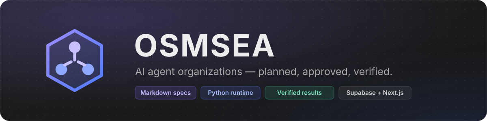
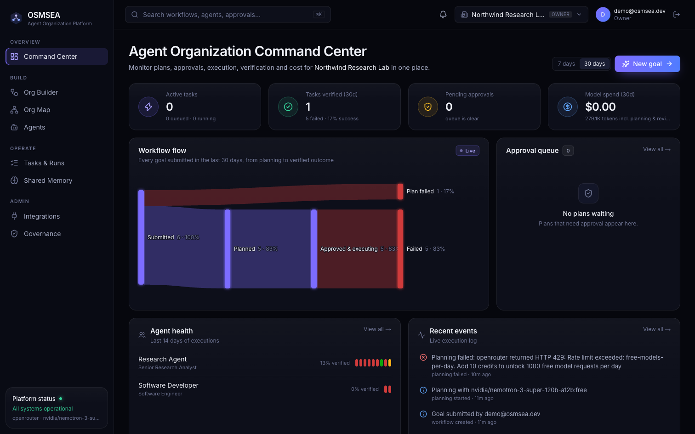
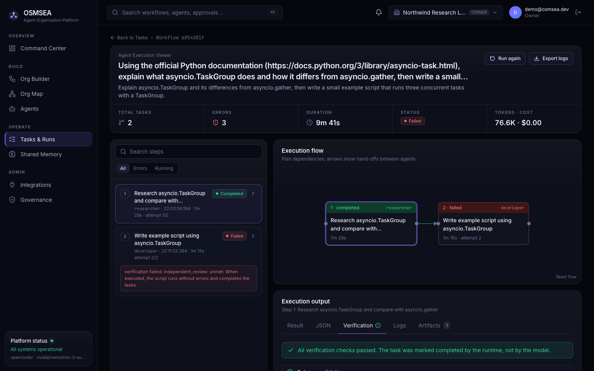
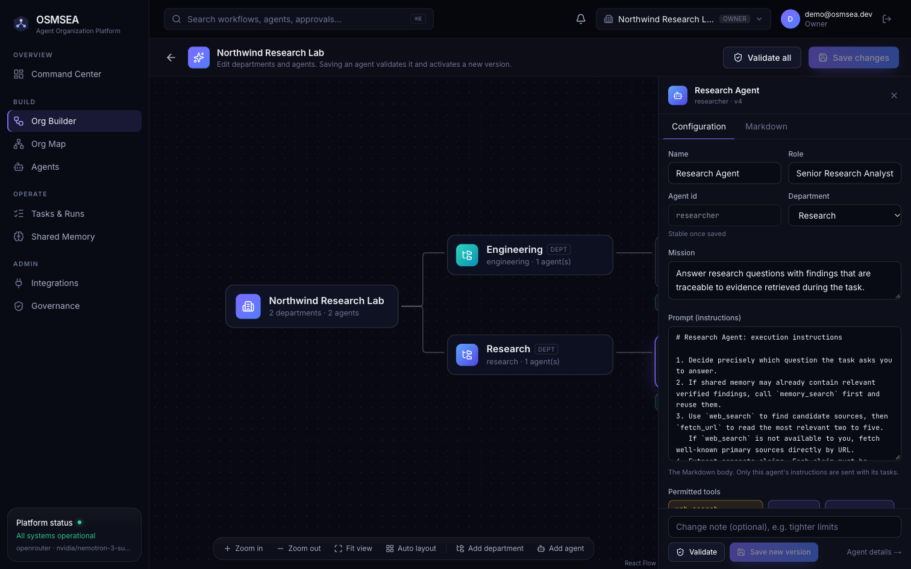
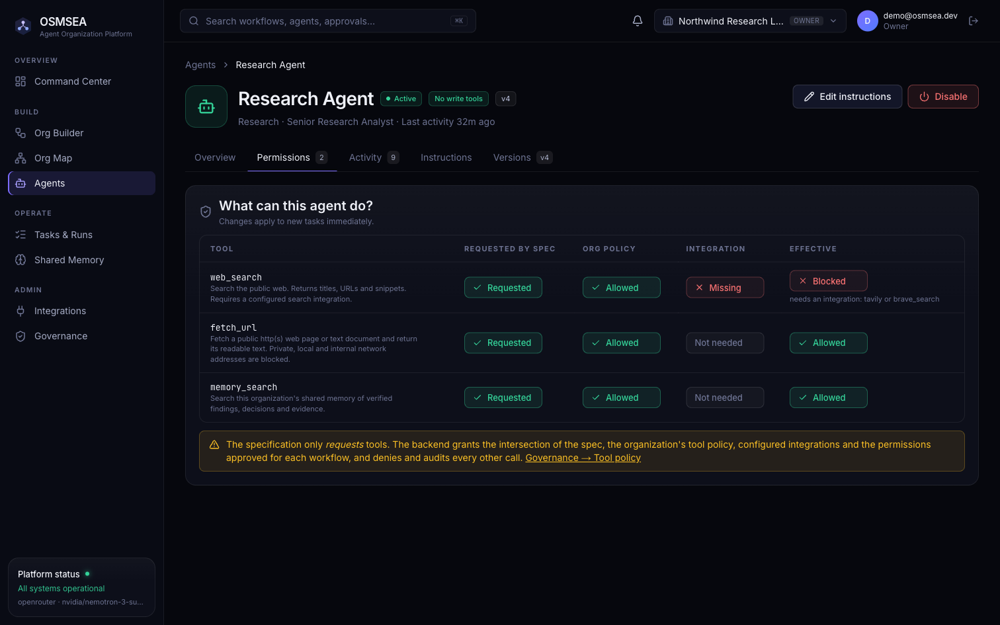
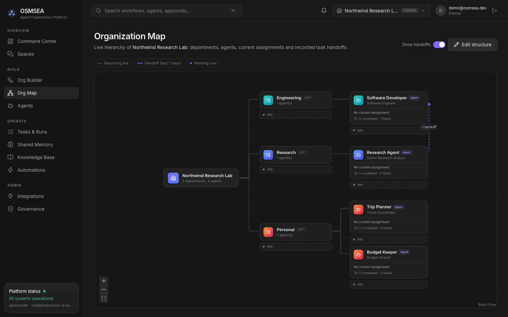
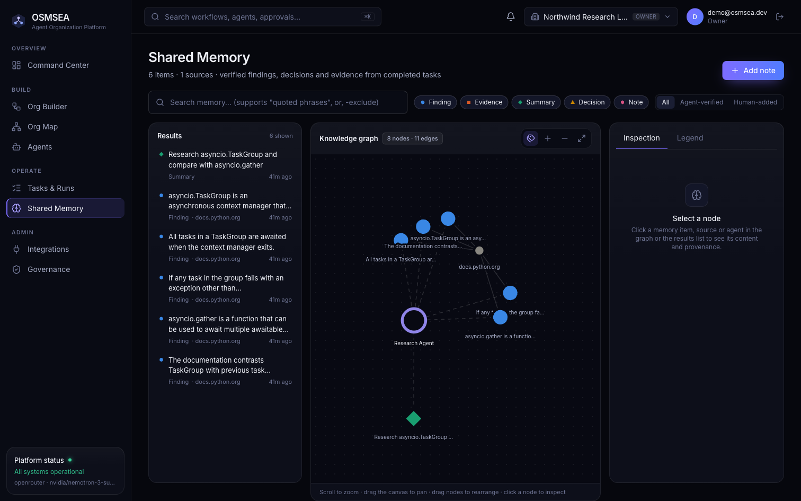
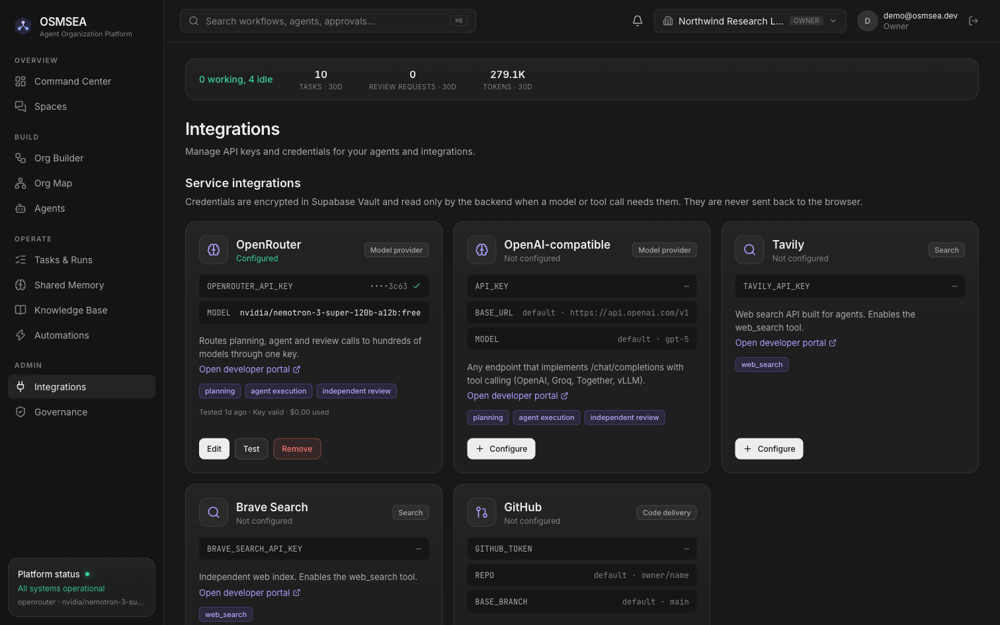
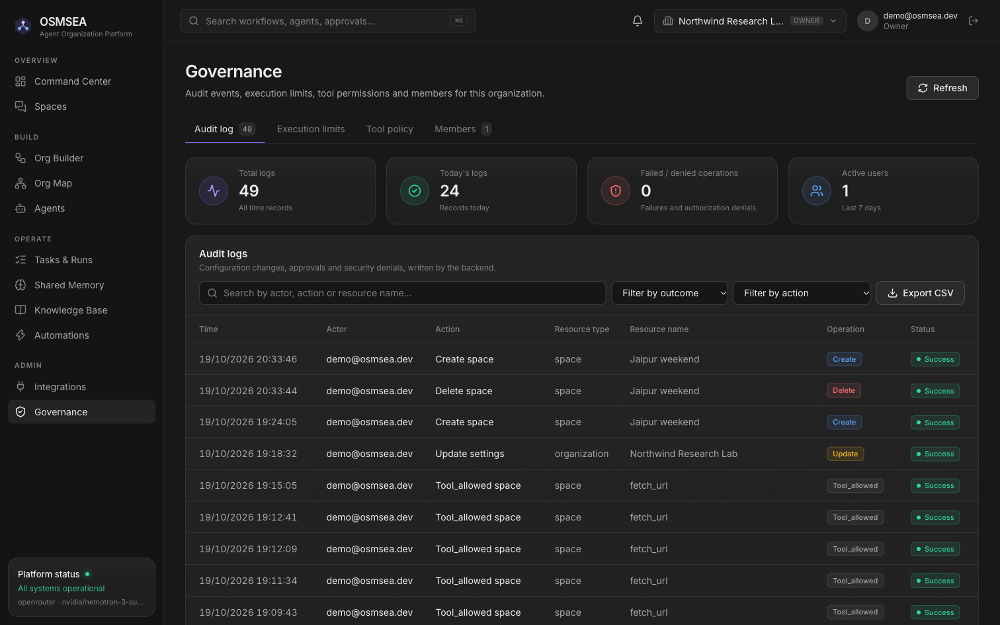
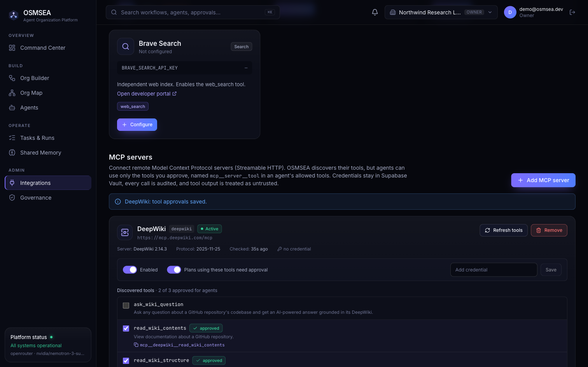

<p align="center">
  
</p>

<p align="center">
  
  
  
  
  
  
  
</p>

> [!WARNING]
> **OSMSEA is in active development (early alpha).** The core loop works end to end: goal, plan,
> approval, execution, verification, persisted results. APIs, the database schema and agent spec
> fields may still change between commits, and several features are not built yet (see
> [Not implemented yet](#not-implemented-yet)). It has not been security-audited or load-tested, so
> don't run it in production or against sensitive data yet.

# OSMSEA

An AI agent organization platform. You define an organization of specialized agents in Markdown,
submit a goal, review the plan the runtime proposes, approve it, and watch agents execute tasks.
A task is marked complete only after verification passes, not because a model says it succeeded.

<p align="center">
  
</p>

| Layer | Technology | Responsibility |
|-------|------------|----------------|
| Specifications | Markdown + YAML frontmatter (`organization/`) | Human-readable agent instructions and org docs, validated by Pydantic |
| Runtime | Python 3.12, FastAPI, Pydantic, httpx (`backend/`) | Planning, scheduling, tool execution, verification, authorization |
| State | Supabase Postgres + Auth + Realtime + Vault (`supabase/migrations/`) | Persistence, RLS tenant isolation, live updates, encrypted credentials |
| UI | Next.js 16, React 19, Tailwind 4, React Flow (`web/`) | Command Center, Builder, Org Map, Agents, Tasks, Memory, Integrations, Governance |

See [docs/ARCHITECTURE.md](docs/ARCHITECTURE.md) for the design,
[organization/workflows/README.md](organization/workflows/README.md) for the workflow lifecycle, and
[organization/policies/README.md](organization/policies/README.md) for the security model and where each rule is enforced.

## Screens

All screens show live data from Supabase. These captures come from real runs against a free
OpenRouter model. The failed tasks are verification rejections (a reviewer model or deterministic check
refused the output), which is the point: nothing is marked complete on the model's word.

| | |
|---|---|
| <br>**Execution viewer**: plan DAG, attempts, tool calls, verification | <br>**Organization Builder**: canvas plus spec inspector |
| <br>**Agent permissions**: spec ∩ policy ∩ integrations | <br>**Organization Map**: hierarchy and recorded hand-offs |
| <br>**Shared memory**: verified findings with provenance | <br>**Integrations**: credentials in Supabase Vault |
| <br>**Governance**: audit log, limits, tool policy | <br>**MCP servers**: discovered tools, per-tool approval |

## Quick start

Prerequisites: Python 3.12 with [uv](https://docs.astral.sh/uv/), Node 22+ with pnpm, a Supabase project, and
Docker (Docker Desktop, OrbStack or Colima) for agents whose tests are executed.

1. **Database.** Apply the migrations in `supabase/migrations/` in order (`supabase db push`, or paste
   them into the SQL editor). They create the tables, RLS policies, Vault-backed secret functions and
   Realtime publication. They are additive; nothing is dropped.
2. **Backend.** Create `backend/.env`:
   ```env
   SUPABASE_URL=https://<project-ref>.supabase.co
   SUPABASE_SECRET_KEY=sb_secret_...          # server only; never expose to the browser
   SUPABASE_PUBLISHABLE_KEY=sb_publishable_...
   OSMSEA_CORS_ORIGINS=http://localhost:3000
   # OPENROUTER_API_KEY=...   optional server-wide fallback; prefer per-org keys in Integrations
   ```
   Then:
   ```bash
   cd backend
   uv sync
   uv run uvicorn osmsea.api:create_app --factory --app-dir src --env-file .env --port 8000
   ```
   The scheduler runs inside this process. `GET /health` shows its last tick. Build the code sandbox
   image once: `docker build -t osmsea-sandbox sandbox/` (Integrations → Code sandbox shows its status).
3. **Web.** Create `web/.env.local`:
   ```env
   NEXT_PUBLIC_SUPABASE_URL=https://<project-ref>.supabase.co
   NEXT_PUBLIC_SUPABASE_PUBLISHABLE_KEY=sb_publishable_...
   NEXT_PUBLIC_API_URL=http://localhost:8000
   ```
   Then `cd web && pnpm install && pnpm dev` and open http://localhost:3000.
4. **First use.** Create an account (or use the local demo login in `.dev-credentials`, if present). Then
   start from the template or describe a goal in the Builder. Open **Integrations** and add an
   OpenRouter key (stored encrypted in Supabase Vault). Then submit a goal from the Command Center.

## What works today

- Agent specs in Markdown with strict validation: unknown tools, unknown output schemas, duplicate ids,
  mismatched departments, path escapes and typos in field names are all rejected.
- Organizations from the template or from a natural-language goal (Builder), with editing of departments
  and agents. Each agent edit creates a new validated, versioned spec; running tasks keep their pinned version.
- Goal → structured plan (objective, criteria, tasks, agents, dependencies). Python validates the plan:
  cycles, unknown agents and dangling dependencies are rejected. The backend computes permissions and the
  approval requirement.
- Approval gate. Scheduler: dependency-aware, per-org concurrency, lease-based claims, bounded retries with
  feedback, timeouts, token budgets, cancellation, restart recovery.
- Agent execution with an allow-listed tool set: `fetch_url` (SSRF-guarded, DNS-pinned), `web_search`
  (Tavily or Brave key required), `memory_search`. Unauthorized tool calls are denied and audited.
- **MCP server integration.** Register remote MCP servers (Streamable HTTP, optional credential kept in Vault).
  OSMSEA discovers their tools, and an admin approves individual tools, which agents request as
  `mcp__<server>__<tool>`. Arguments are validated against the tool's schema, output is treated as
  untrusted, every call is audited, and plans using MCP tools need approval by default.
- Verification: schema validation; cited sources must have been retrieved during the same execution;
  minimum sources; Python/JSON/TOML/YAML parse checks; an independent reviewer model judges the
  acceptance criteria. Artifacts and verified findings are stored with provenance.
- **Self-improving agents** (agent → Improve tab):
  - **Evaluation cases ("CI for agents").** Every attempt that reaches verification is frozen as a
    regression case, together with the full results of its tool calls.
  - **Replayed evaluations.** An evaluation replays those cases against a spec or model. Recorded tool
    calls are answered from the recording, MCP tools never run live, and real tasks are never touched.
    Results are compared with the recorded baseline.
  - **Activation gate (optional).** A new agent version goes live only after an evaluation of that exact
    spec passes at least as many cases as before.
  - **Improvement proposals.** A model drafts a revised spec from the agent's failure patterns: failed
    checks and the criteria the reviewer marked unmet. The backend rejects any proposal that adds tools,
    disables a verification check or changes the agent's identity. Each proposal is evaluated, then an
    admin accepts or rejects it.
  - **Cost-aware model routing (optional).** For each agent, OSMSEA tracks pass rate and cost per
    verified task for each model, from real runs and evaluations. Auto-routing picks the cheapest model
    that meets the org's quality bar. A model pinned in a spec always wins, and every execution records
    why its model was chosen.
- **Tests that actually run.** Agents with `verification.run_tests` (the template developer) must ship pytest
  tests and a `test_command`. Verification runs them in a locked-down Docker container: no network, read-only
  root filesystem, unprivileged user, no capabilities, and memory, CPU, process and time limits. Files go in
  as a tar stream and nothing from the host is mounted. A failing test fails the task, and its output becomes
  the feedback for the next attempt. The reviewer sees the trusted exit code.
- **OSMSEA as an MCP server.** Claude Code, Cursor, Claude Desktop or any MCP client can connect to `/mcp`
  with an organization API token. It exposes `list_agents`, `submit_goal`, `get_workflow` (with waiting)
  and `search_memory`. Clients cannot approve plans: plans that need approval wait for a human in the UI.
  Tokens are stored hashed, shown once, revocable and audited.
- **Automations.** Goals can run on a schedule (every 15 minutes to every year) or from a webhook, with the
  secret in a Bearer header or `?token=`. Webhook payloads reach the planner only as untrusted data. Plans
  from automations need approval by default, and a run is skipped while the previous one is still active.
- Live UI over real data through Supabase Realtime. Audit log of configuration changes, approvals and
  security denials.

## Not implemented yet

Mid-task approval of individual tool calls · member invitations · OAuth for OSMSEA's MCP server
(static tokens today) · cron expressions for schedules (fixed intervals today) · sandboxes for languages
other than Python · a separate worker process (the scheduler runs in the API process).

## Tests

```bash
cd backend
uv run pytest -q                                          # 78 tests: scripted model, in-memory store, in-process MCP servers, real sandbox if Docker is up
OSMSEA_LIVE=1 uv run pytest tests/test_live_supabase.py   # real Supabase: persistence, RLS isolation, Vault
OSMSEA_LIVE_MCP=1 uv run pytest tests/test_mcp.py        # real public MCP server (DeepWiki)
cd ../web && pnpm exec tsc --noEmit && pnpm lint && pnpm build
```

## Troubleshooting

- **`ModuleNotFoundError: osmsea`** when starting uvicorn: keep `--app-dir src`. On macOS folders synced
  by iCloud (e.g. `~/Desktop`), virtualenv `.pth` files can be flagged hidden and Python skips them.
- **429 from OpenRouter on `:free` models**: free models have a small daily request quota. Workflows
  fail with the provider's message rather than hanging; add credits or choose a paid model in Integrations.

## Project status

In development. Next on the roadmap: a fully verified multi-agent run on a production model, cost and
success forecasts before approval, time-travel debugging of runs, MCP OAuth, member invitations, and a
separate worker process. Issues and suggestions are welcome.

## License

[MIT](LICENSE) © 2026 Malyaj Nailwal
